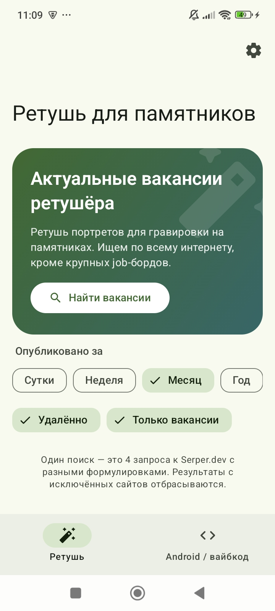
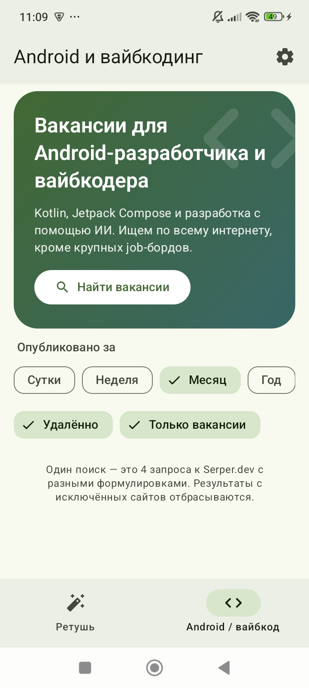
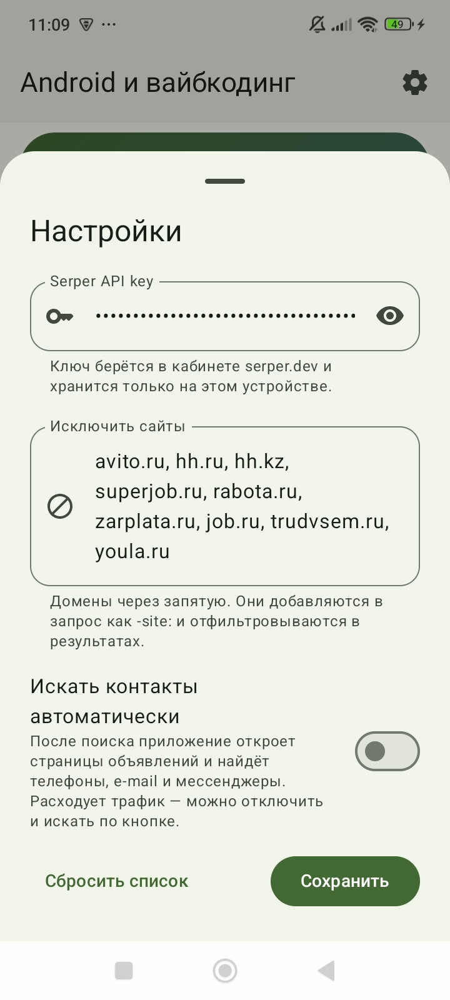

<div align="center">

# 🔎 RetouchJobs

**Android-приложение для поиска актуальных вакансий через Serper.dev**

Находит вакансии, собирает контакты для связи и не трогает крупные job-борды.


[](https://github.com/alekssavichev87-dot/RetouchJobs/actions/workflows/build.yml)

</div>

---

## О проекте

Приложение ищет в интернете свежие вакансии в трёх нишах и показывает их в удобной ленте с контактами работодателя. Поиск идёт через [Serper.dev](https://serper.dev) (API к выдаче Google). Avito, hh.ru, SuperJob и другие крупные job-борды **не используются**: они исключаются из запроса и повторно отфильтровываются в результатах.

### Разделы

| Раздел | Что ищем |
|---|---|
| **Ретушь** | Ретушёр фото для гравировки на памятниках |
| **Android / вайбкод** | Android-разработчик (Kotlin, Jetpack Compose) и вайбкодер (разработка с помощью ИИ) |
| **Дизайн** | Дизайнер карточек товаров и инфографики для маркетплейсов (Wildberries, Ozon и др.) |

## Возможности

- **Поиск через Serper.dev.** Один поиск раздела — 4 запроса с разными формулировками, результаты объединяются и убираются дубли.
- **Оценка релевантности.** Каждая вакансия получает метку: «Точное совпадение», «По теме» или «Возможно по теме». Лучшие результаты показываются первыми.
- **Исключение сайтов.** Список доменов редактируется в настройках.
- **Контакты для связи.** Телефоны, e-mail, Telegram, WhatsApp и VK достаются из сниппета, со страницы объявления, а при необходимости со страницы «Контакты» того же сайта. На карточке это кнопки: звонок, письмо, переход в мессенджер.
- **Фильтры.** Период публикации (сутки, неделя, месяц, год), «Удалённо», «Только вакансии».
- **Современный интерфейс.** Material 3, динамические цвета на Android 12+, светлая и тёмная тема, нижняя навигация, сворачивающийся заголовок, pull-to-refresh, анимированные заглушки загрузки.
- **Понятные ошибки.** Нет ключа, неверный ключ, исчерпан лимит, нет сети.
- **Приватность.** API-ключ хранится только на устройстве, резервное копирование отключено.

## Скриншоты

<p align="center">
  
  
  
</p>

## Технологии

| Область | Что использовано |
|---|---|
| Язык | Kotlin 2.0.21 |
| UI | Jetpack Compose (BOM 2024.12.01), Material 3, Material Icons Extended |
| Асинхронность | Kotlin Coroutines, Flow, StateFlow |
| Сеть | OkHttp 4.12 |
| JSON | kotlinx.serialization 1.7 |
| Хранение настроек | Jetpack DataStore (Preferences) |
| Архитектура | MVVM: `AndroidViewModel` + однонаправленный поток состояния |
| Сборка | Gradle 8.9, Android Gradle Plugin 8.7, Version Catalog (`libs.versions.toml`) |
| Платформа | minSdk 26 (Android 8.0), targetSdk / compileSdk 35, JVM 17 |

## Структура проекта

```
app/src/main/java/com/example/retouchjobs/
├── MainActivity.kt              # точка входа, edge-to-edge
├── data/
│   ├── Models.kt                # модели Serper, Category, Vacancy, Period
│   ├── SerperClient.kt          # запросы к Serper.dev, разбор ошибок
│   ├── VacancyRepository.kt     # запросы раздела, фильтрация, оценка совпадений
│   ├── Contacts.kt              # извлечение телефонов, e-mail, мессенджеров
│   ├── ContactFetcher.kt        # загрузка страницы объявления
│   └── SettingsStore.kt         # DataStore: ключ, фильтры, исключённые домены
└── ui/
    ├── MainViewModel.kt         # состояния разделов и поиск контактов
    ├── MainScreen.kt            # экран, навигация, список
    ├── Components.kt            # карточки, фильтры, заглушки, ошибки
    ├── SettingsSheet.kt         # шторка настроек
    └── theme/Theme.kt           # цветовые схемы Material 3
```

## Как это работает

1. Пользователь нажимает «Найти вакансии». `VacancyRepository` берёт 4 запроса раздела, добавляет к ним `-site:` для каждого исключённого домена и отправляет их параллельно в Serper.
2. Результаты объединяются, повторно фильтруются по доменам, получают оценку совпадения по ключевым словам раздела и сортируются.
3. Для каждой вакансии контакты ищутся в заголовке и сниппете, затем (если включено в настройках) на странице объявления. Одновременно загружается не больше 4 страниц.
4. Состояние каждого раздела хранится отдельно, `StateFlow` обновляет интерфейс на Compose.

## Запуск

**Требования:** Android Studio Ladybug или новее, JDK 17 (поставляется со студией как `jbr-17`), устройство или эмулятор с Android 8.0+.

```bash
git clone https://github.com/alekssavichev87-dot/RetouchJobs.git
```

1. Откройте папку проекта в Android Studio и дождитесь Gradle Sync.
2. Если студия ругается на версию Java, выберите JDK 17: *Settings → Build, Execution, Deployment → Build Tools → Gradle → Gradle JDK*.
3. Запустите приложение (`Run ▶`).
4. Получите бесплатный ключ на [serper.dev](https://serper.dev) (в кабинете: *Dashboard → API key*).
5. В приложении нажмите на шестерёнку, вставьте ключ и сохраните.

> Ключ **не** хранится в репозитории: его вводят в приложении, и он остаётся только на устройстве.

## Версия для Windows

В папке [`desktop/`](desktop) лежит настольная версия на Compose Multiplatform: те же экраны, поиск, фильтры и контакты. Android-приложение она не затрагивает.

Готовый `RetouchJobs.exe` собирается автоматически: на вкладке **Actions** откройте *Windows build* → *Run workflow*, дождитесь зелёной галочки и скачайте архив из блока **Artifacts**. Внутри портативная версия (распаковать и запустить `RetouchJobs.exe`), а при успешной сборке установщик `.exe` или `.msi`.

Отличия от телефона: свои цвета вместо Material You, настройки открываются окном, «Поделиться» и номера телефонов копируются в буфер обмена, ключ и настройки лежат в `%APPDATA%\RetouchJobs`.

## Ограничения

- Контакты находятся только на страницах, которые открываются без входа в аккаунт. Если номер скрыт за кнопкой «Показать телефон» и подгружается скриптом, приложение его не увидит.
- Разбор страниц работает по шаблонам, поэтому возможны лишние или пропущенные контакты. Перед звонком или письмом сверяйте их с объявлением.
- Выдача Serper — это обычный поиск Google, поэтому среди результатов бывают сайты компаний, а не только вакансии. Для этого есть фильтр «Только вакансии».
- Каждый поиск расходует кредиты Serper (4 запроса на раздел).

## Планы

- [ ] Избранное и скрытие вакансий
- [ ] Локальная база (Room) и работа без сети
- [ ] Уведомления о новых вакансиях
- [ ] Свои разделы поиска в настройках
- [ ] Скриншоты с результатами поиска и локализация на английский

## Как добавить свой раздел

Раздел описан в `Category` (`data/Models.kt`): название, четыре поисковых запроса, главные и уточняющие слова для оценки совпадения. Добавьте новый элемент enum и иконку в `Category.icon()` (`ui/MainScreen.kt`), и он появится в нижней навигации.

## Об использовании

Приложение работает только с общедоступными данными. Соблюдайте правила сайтов, с которых получаете информацию, и законодательство о персональных данных: найденные контакты предназначены для связи по конкретной вакансии.

Проект создан с помощью ИИ (Claude) в формате вайбкодинга.

## Лицензия

[MIT](LICENSE)
